<h1 align="center">Rakotonandrasana Landry</h1>
<h3 align="center">Software Developer at 42 Antananarivo | Full-Stack Web • Automation • AI Solutions</h3>

Python • TypeScript • Next.js • C/C++ • API Integration • Automation • Linux

---

## About Me

I am a **software developer trained at 42 Antananarivo**, driven by problem-solving and building reliable, user-focused solutions.  
With a strong foundation in **low-level programming (C/C++) and Linux environments**, I focus on **full-stack web development (Next.js, TypeScript, NestJS)**, **workflow automation**, and **AI integration (LLM, RAG)**.

I enjoy turning complex technical challenges into clean, well-documented, and maintainable tools for real-world use.

---

## Tech Stack

### Languages

### Web & Backend

### Systems, DevOps & Tools

---

## Featured Projects

### ft_transcendence — Full-Stack Web Application
Collaborative team project where I acted as **Web Designer & Lead Frontend Developer**:
- **UI/UX & Frontend:** Built role-based dashboards and a reusable design system using **Next.js, React, TypeScript, and TailwindCSS**.
- **Core Integrations:** Implemented secure authentication (**JWT, OAuth, 2FA**), online payments (**Stripe**), and real-time chat (**WebSockets**) connected to a **NestJS / PostgreSQL** backend.

### Inception
**Docker-based infrastructure project** orchestrating isolated services:
- NGINX, WordPress, and MariaDB configured via Docker Compose and custom Dockerfiles.

### IRC Server
**Custom IRC server written in C++98** supporting:
- Multi-client non-blocking I/O, channel management, and standard IRC protocol commands.

### Minishell
Minimal Unix shell written in **C** featuring:
- Command parsing, environment variable management, pipes, redirections, and signal handling.

---

## Certifications

**Cisco Networking Academy**
- Python Essentials 1  
- JavaScript Essentials 1  
- Getting Started with Cisco Packet Tracer  

---

## GitHub Statistics

---

## Contribution Activity

---

## Contact

**LinkedIn:** [Rakotonandrasana Landry](https://www.linkedin.com/in/rakotonandrasana-landry-75a245294/)  
**GitHub:** [larakoto](https://github.com/larakoto)
